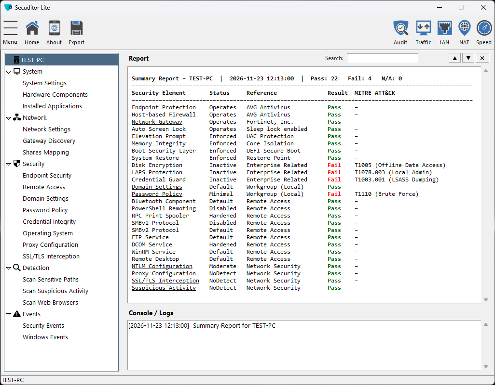
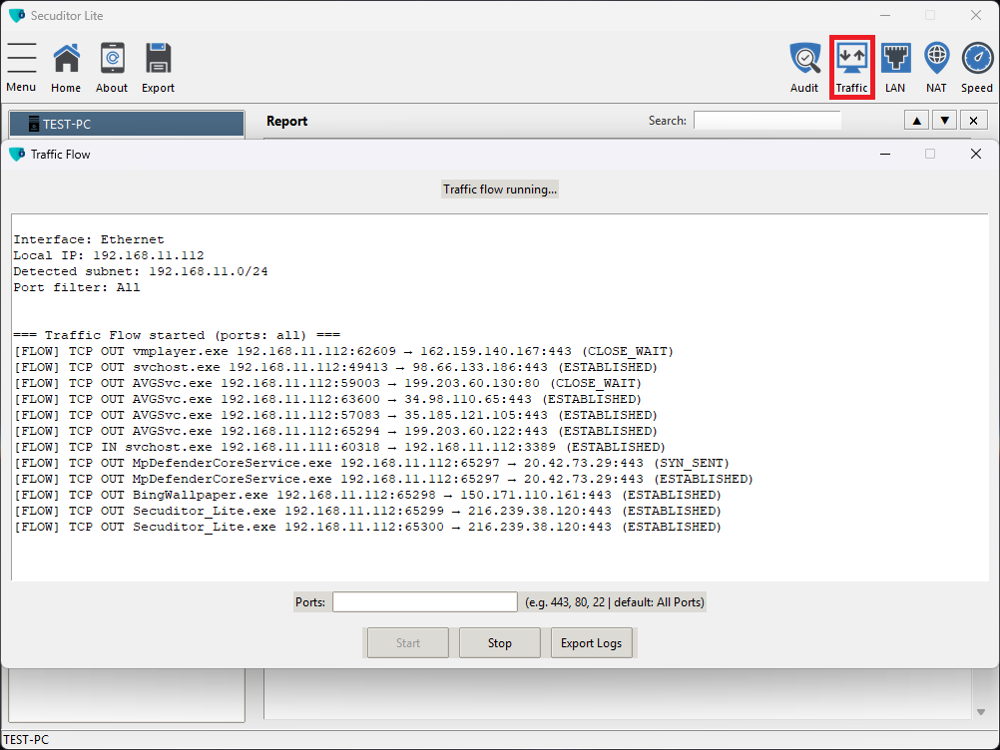
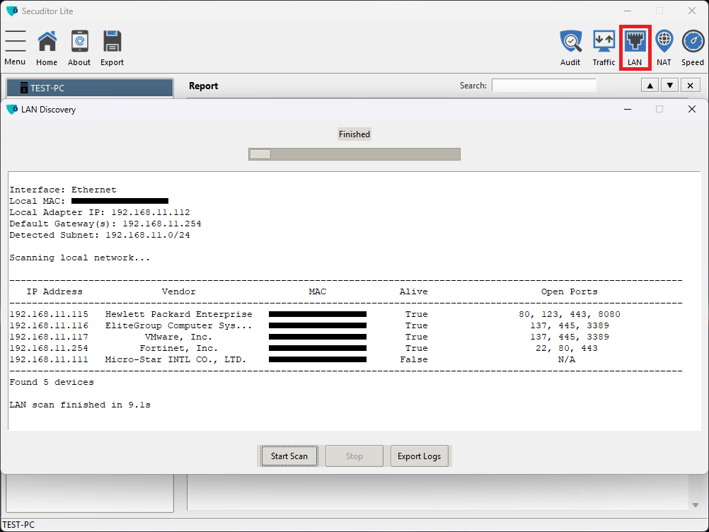

<a name="top"></a>

<div align="center" style="line-height: 0;">
  <a href="https://github.com/secuditor/secuditor-lite">
    
  </a>
</div>

<br>

<div align="center">
<a href="#introduction"><b>Introduction</b></a> &nbsp; ✦ &nbsp;
<a href="#presentation"><b>Presentation</b></a> &nbsp; ✦ &nbsp;
<a href="#getting-started"><b>Download</b></a> &nbsp; ✦ &nbsp;
<a href="#safety-ethics"><b>Safety & Ethics</b></a> &nbsp; ✦ &nbsp;
<a href="#open-source"><b>Open Source</b></a> &nbsp; ✦ &nbsp;
<a href="#more-info"><b>More Info</b></a>
</div>

---
<br>

<a name="introduction"></a>

# Secuditor Lite – Windows Security Tool

**Secuditor Lite** is a free, Python-based diagnostic security tool for Windows endpoints and networks, featuring a user friendly GUI. It provides a simple and transparent way to assess system security, helping users identify vulnerabilities, suspicious activity, and misconfigurations while improving device Operational Security (OPSEC).

The tool also detects network elements, runs internet speed tests, and generates structured audit reports, all in one place. Suitable for both personal and organizational environments. Built for ethical security auditing.

Our **[privacy](PRIVACY.md)** and **[security](SECURITY.md)** policies are detailed in these documents.

---
<br>

## Key Features

- Quick and comprehensive endpoint security evaluation
- Built-in Windows and network discovery auditing tools
- Practical SSL interception and traffic flow analysis modules
- Enhanced configuration checks and diagnostic summary
- Structured and easy to export plain text (TXT) reports
- More analytical capabilities with improved security insights

---
<br>

## Security Checks & Diagnostics

**Secuditor Lite** analyzes Windows systems across:

- System overview & hardware analysis
- Network configuration & LAN discovery
- Shared folders & permissions mapping
- Security controls (AV, EDR, Firewall, UAC, and more)
- Remote access & server roles analysis
- Credential integrity & password policies
- Domain settings & user access
- Sensitive data and paths exposure
- Suspicious processes and connections
- SSL interception analysis
- Security event log audit

➡️ See the full Checklist: [Security Checklist](SECURITY_CHECKLIST.md)

---
<br>

## Standard Edition

### Compatible with:
- Windows 10 / 11
- Windows Server 2016 / 2019 / 2022

---
<br>

<a name="presentation"></a>

## Presentation (Windows 11)

*Secuditor Lite summary report*
<p align="center">
  <a>
    
  </a>
</p>

<br>

*Secuditor Traffic Flow module*
<p align="center">
  <a>
    
  </a>
</p>

<br>

*Secuditor LAN Discovery module*
<p align="center">
  <a>
    
  </a>
</p>

---
<br>

<a name="getting-started"></a>

## Getting Started – Windows Release

### 1️⃣ Download
- #### [SecuditorLite_2.4.0.zip](https://github.com/secuditor/secuditor-lite/releases/download/2.4.0/SecuditorLite_2.4.0.zip) (21.3 MB)
- **SHA-256:** 65e1fdfb5e480ebb99f4a00c2498ef54f300bc97b6079a610040050500aca843

### 2️⃣ Extract & Run
- Unzip the file
- Double-click **SecuditorLite.exe**
- For all features to work it is recommended to "Run as administrator"

### 3️⃣ Navigation
- Standard mouse left and right clicks
- Keyboard arrow keys for navigating the categories table

### 4️⃣ Toolbar buttons (right to left):
- Internet speedtest
- NAT public IP
- LAN Discovery module
- Traffic Flow module
- Security Audit
- Export report
- About
- Home
- Menu

---
<br>

<a name="safety-ethics"></a>

## Safety Notice

Secuditor Lite is an open-source, digitally signed security diagnostic tool for Windows.

For your security, download the software only from the official distribution channels listed on our website or the project's official GitHub repository.

Some antivirus or endpoint security products may incorrectly flag or block the application (false positive detections).

If you believe the detection is incorrect, verify the application's digital signature and download source before considering an antivirus exception or restoring the file from quarantine. If you are unsure, contact the developer.

### Microsoft Defender SmartScreen

Microsoft Defender SmartScreen may display a warning when running Secuditor Lite because it is a relatively new application and may not yet have established sufficient reputation.

If you encounter a SmartScreen warning:

1. Click **More info**.
2. Verify that the publisher is **Menahem Levinski**.
3. If you trust the application, click **Run anyway** to proceed.

---
<br>

## Ethical Use

**Secuditor Lite** is intended solely for lawful and authorized use.
You must obtain explicit permission from the network owner before scanning, auditing, or testing any systems.
The author assumes no liability for misuse or for actions that violate applicable laws or organizational policies.
Use responsibly and in compliance with your local governance.

---
<br>

<a name="open-source"></a>

## Open Source

Secuditor Lite is now open-source! You can explore, review, and contribute to the source code available in the **[src](./src/)** folder.

Contributions, suggestions, and bug reports are welcome (please see our **[Contributing](./CONTRIBUTING.md)** guidelines).

### Requirements

- `Windows 10` or `Windows 11`
- `Python 3.10` or later (tested with `Python 3.13.5`)


### Python Dependencies

The following third-party packages are required:

```text
requests>=2.32.0
urllib3>=2.0.0
certifi>=2024.0.0
psutil>=5.9.0
cryptography>=42.0.0
pywin32>=306; sys_platform == "win32"
WMI>=1.5.1; sys_platform == "win32"
```

### Running from Source

To run Secuditor Lite directly from Python:

1. Clone the repository:

```bash
git clone https://github.com/secuditor/secuditor-lite.git
```

2. Navigate to the project directory:

```bash
cd secuditor-lite
```

3. Install the required dependencies:

```bash
pip install -r requirements.txt
```

4. Run the application:

```bash
python src/secuditor_lite_main.py
```

**Note:** Some security checks and system operations may require administrator privileges.

For more technical details about the application architecture, modules, and implementation, see **[TECHNICAL_OVERVIEW.md](./TECHNICAL_OVERVIEW.md)**.

Secuditor Lite's original source code is distributed under the MIT License.

The Secuditor name, logos, and original branding elements are not included in the MIT License.

Third-party packages and bundled assets remain subject to their respective licenses and attribution requirements.

See the following files for details:

- **[LICENSE.txt](./LICENSE.txt)** – MIT License and branding restrictions.
- **[THIRD_PARTY_LICENSES.txt](./THIRD_PARTY_LICENSES.txt)** – Third-party licenses and attributions.

---
<br>

<a name="more-info"></a>

## Info, Links and Licenses

- **[Changelog](CHANGELOG.md)**
- **[Contributing](CONTRIBUTING.md)**
- **[Privacy Policy](PRIVACY.md)**
- **[Security Policy](SECURITY.md)**
- **[TECHNICAL_OVERVIEW.md](./TECHNICAL_OVERVIEW.md)**

<br>

- **Website:** [secuditor.com](https://secuditor.com/)
- **Contact:** info@secuditor.com
- **GitHub:** [github.com/secuditor](https://github.com/secuditor)

---
<br>

## 📁 Project Structure

```text
secuditor-lite/                       # Main repository root
│
├── img/                              # Documentation screenshots & logo
│
├── src/                              # Application source code & assets
│   ├── data/sec.json                 # Detection patterns, paths & CA/issuer lists
│   ├── icons/                        # GUI & tree icons
│   ├── icon.ico                      # Application icon
│   ├── secuditor_lite_main.py        # Main Tkinter GUI & scoring engine
│   ├── secuditor_modules.py          # Windows system, security & update audits
│   ├── secuditor_scanners.py         # SSL/TLS, proxy, process & path scanners
│   ├── secuditor_utilities.py        # Traffic Flow, LAN Scanner, NAT & Speed Test
│   └── secuditor_loader.py           # Local OUI SQLite cache updater
│
├── CHANGELOG.md                      # Project change log
├── CONTRIBUTING.md                   # Contribution guidelines
├── LICENSE.txt                       # MIT License + branding terms
├── PRIVACY.md                        # Privacy Policy
├── README.md                         # Project overview
├── requirements.txt                  # Python dependencies
├── SECURITY.md                       # Security policy
├── SECURITY_CHECKLIST.md             # Security Checks & Diagnostics
├── TECHNICAL_OVERVIEW.md             # Architecture documentation
└── THIRD_PARTY_LICENSES.txt          # Third-party licenses
```

---
<br>
<p align="center">
© 2026 Menahem Levinski. All rights reserved.
<a href="#top">🔝</a>
</p>
